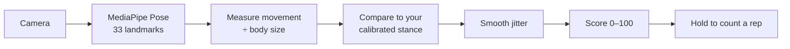

<div align="center">

# StepAlong

**Camera-based movement practice with live feedback. No wearables, no sign-up, nothing to install.**

Stand in front of your phone or laptop, pick a routine, and StepAlong watches your movement in real time,<br/>
scores how closely you match the target, and counts your reps.

[**▶ Try it live**](https://advikaaaaa.github.io/stepalong/) · [How the scoring works](docs/scoring.md) · [Run it locally](#run-it-locally)


<table>
  <tr>
    <td align="center"><br/><sub><b>Pick a routine</b></sub></td>
    <td align="center"><br/><sub><b>Live score and rep counting</b></sub></td>
    <td align="center"><br/><sub><b>Results and adaptive difficulty</b></sub></td>
  </tr>
</table>

<sub>Screenshots use the real pose model. The camera image is hidden so only the tracked skeleton shows.</sub>

</div>

<!--
## Why I built this

TODO (Advika): your own story goes here: who this is for and why it matters to you.
Keep it short and specific. Use the same story on the app's intro screen.
-->

## What it does

- **Live match score (0–100).** It updates many times a second as you move, with a gauge that turns green when you're on target.
- **Reps that only count when they're real.** You have to *hold* a good position for about half a second, then reset, so passing through a pose or holding still doesn't count.
- **Calibrates to you.** During the 3-2-1 countdown it measures how *you* naturally stand, so it works for different bodies, postures and camera distances.
- **Gets harder as you improve.** Three difficulty tiers per routine. Score well and the target movement grows, and the beat speeds up.
- **On-beat practice.** Rhythm routines include an optional metronome with a visual pulse.
- **Progress tracking.** Rounds, total reps, a day streak and a score trend chart, all saved in your browser.

## Routines

| | Routine | What you do | Focus |
|---|---|---|---|
| ⚖️ | **Standing Sway** | Shift your weight smoothly from side to side | Balance |
| 👣 | **Heel-Toe Rocker** | Rock between heels and toes, on the beat | Balance |
| 🤸 | **Cross-Body Horizon** | Reach one hand across your body to the far side | Coordination |
| 🥁 | **Exaggerated March** | March in place with high knees, on the beat | Gait |

Each routine includes a short **"Research behind this routine"** note on the published movement research that inspired it, such as rhythmic auditory cueing in gait research.

## Built for accessibility

StepAlong is meant for people who may have limited mobility, so accessibility is built in:

- **Aa** large text
- **◐** high-contrast mode
- **🔊** spoken feedback ("Nice, that counted"), so you don't have to watch the screen
- Automatic dark mode and a mobile-first layout
- First-run **setup tips** for camera placement, lighting and a safe practice space

## Privacy

**Your camera video never leaves your device.** Pose tracking runs entirely in your browser using Google's [MediaPipe Pose](https://github.com/google-ai-edge/mediapipe) model. Nothing is uploaded, recorded or stored. StepAlong only saves your round scores, in your own browser's local storage, and you can erase them at any time from the Progress screen.

## How it works



The hard part is making a noisy camera estimate feel fair and steady:

1. **Body-size normalization.** Every distance is divided by your shoulder width or torso length, so it works near or far, for any body size.
2. **Personal baseline.** Your neutral stance is measured during the countdown, and you're scored on movement *away* from it.
3. **Jitter smoothing.** An exponential moving average stops the score from flickering between 0 and 100.
4. **Hold-to-count reps.** A rep needs about 0.5 s at 70+, then a reset below 35, so passing through a pose or holding still can't add reps.

The full explanation, with the formulas and per-routine measurements, is in **[docs/scoring.md](docs/scoring.md)**.

## Run it locally

The camera needs `https://` or `localhost`, so open the app through a local server rather than double-clicking the file.

```bash
git clone https://github.com/advikaaaaa/stepalong.git
cd stepalong
npm install
npm run dev          # → http://localhost:8001
```

No Node.js? `python3 -m http.server 8001` works too.

Run the tests:

```bash
npm test             # syntax check + end-to-end test of every routine
```

The test plays a full round of each routine in a simulated browser with fake body poses. It checks that moving counts reps, standing still counts none, and results are saved.

## Project structure

```
index.html        screens and layout
styles.css        styling, colour theme, dark and high-contrast modes
app.js            routines, pose scoring, round timer, progress tracking
tests/            end-to-end smoke test
docs/scoring.md   how the scoring works
```

Plain HTML, CSS and JavaScript, with no framework and no build step. It deploys as static files to GitHub Pages.

## Built with

- [MediaPipe Pose](https://github.com/google-ai-edge/mediapipe) for on-device body landmark detection
- Web Audio API for the metronome and the Web Speech API for voice feedback
- Inline SVG for icons and charts, and `localStorage` for progress
- [Fraunces](https://fonts.google.com/specimen/Fraunces) and [Inter](https://fonts.google.com/specimen/Inter) fonts

## License

[MIT](LICENSE) © 2026 Advika Mangal

## Disclaimer

StepAlong is a student-built prototype, **not a medical device**. Routines are inspired by published movement research but have not been clinically tested. If you have a health condition, talk to a doctor or physical therapist before starting a new exercise routine. Stop if you feel dizzy or unwell.

---

<div align="center"><sub>Made by Advika Mangal for the 2026 Congressional App Challenge.</sub></div>
