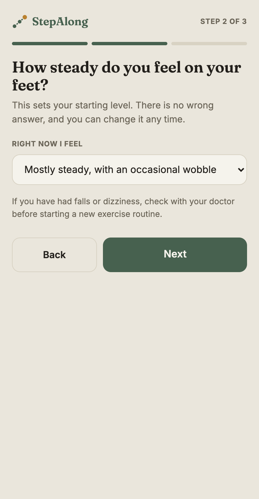
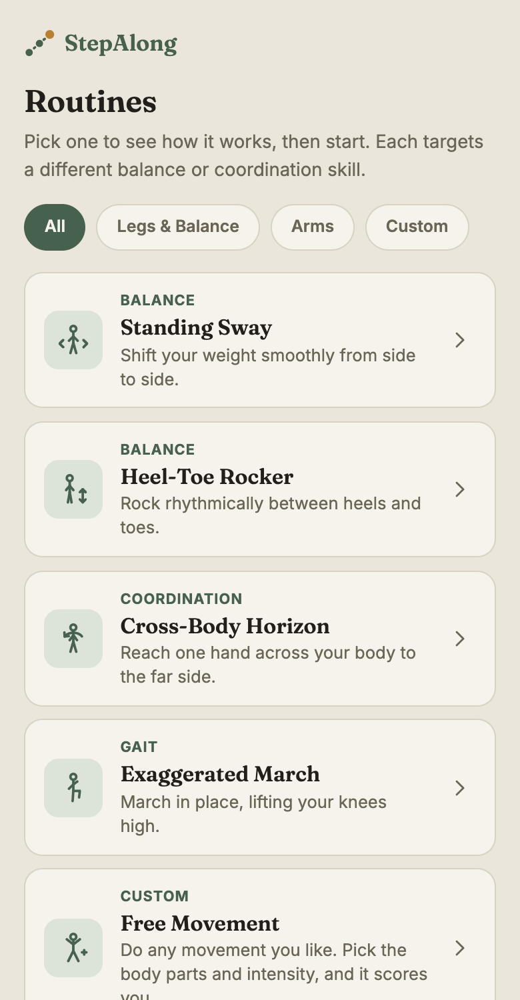
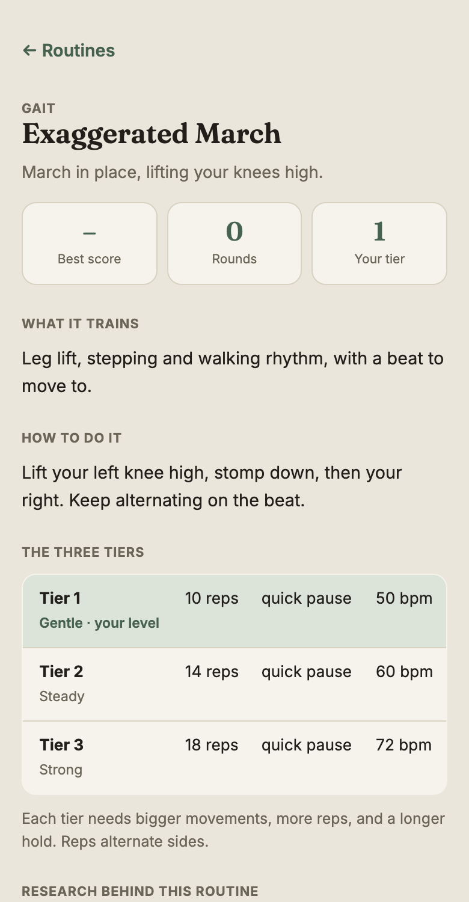
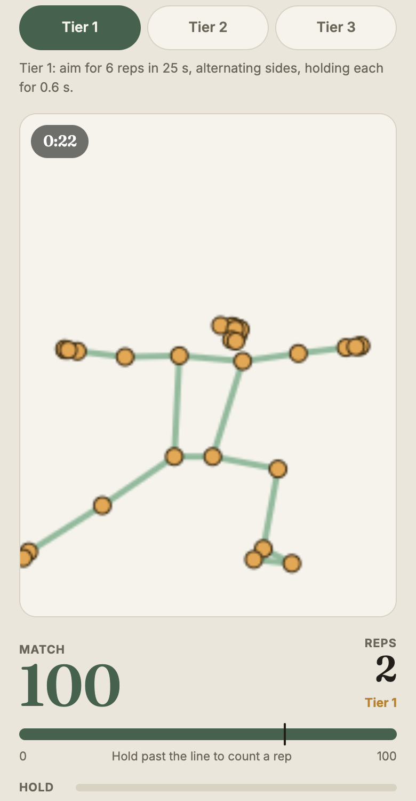
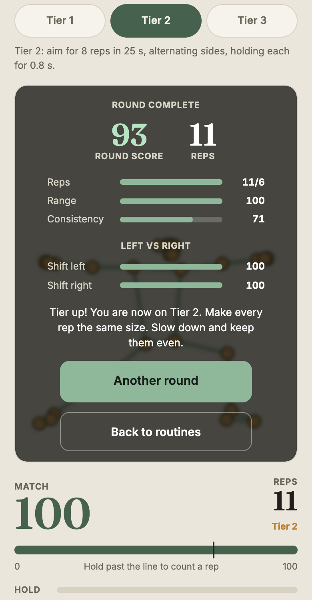
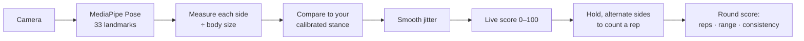

<div align="center">

# StepAlong

**Your camera is the coach. Movement practice with live feedback: no wearables, no sign-up, nothing to install.**

Stand in front of your phone or laptop, pick a routine, and StepAlong watches your movement in real time,<br/>
scores each rep, counts them, and tells you what to work on next.

[**▶ Try it live**](https://advikaaaaa.github.io/stepalong/) · [How the scoring works](docs/scoring.md) · [Run it locally](#run-it-locally)


<table>
  <tr>
    <td align="center"><br/><sub><b>Quick first-time setup</b></sub></td>
    <td align="center"><br/><sub><b>Pick a routine</b></sub></td>
    <td align="center"><br/><sub><b>Learn how it works</b></sub></td>
    <td align="center"><br/><sub><b>Live score and reps</b></sub></td>
    <td align="center"><br/><sub><b>Results and a tip</b></sub></td>
  </tr>
</table>

<sub>Practice and results screenshots use the real pose model. The camera image is hidden so only the tracked skeleton shows.</sub>

</div>

<!--
## Why I built this

TODO (Advika): your own story goes here: who this is for and why it matters to you.
Keep it short and specific. Use the same story on the app's intro screen.
-->

## What it does

- **Starts where you are.** A three-step setup asks what you want to work on and how steady you feel, then suggests a first routine and a starting level. Anyone who feels unsteady starts at the gentlest level, with a safety note.
- **Live match score (0–100).** It updates many times a second as you move, with live coaching cues such as "A little further" or "Now shift to your right".
- **Reps that only count when they're real.** You have to *hold* a good position for the tier's hold time, then reset, and reps must alternate sides. Passing through a pose, or repeating the same side, doesn't count.
- **Calibrates to you.** During the 3-2-1 countdown it measures how *you* naturally stand, so it works for different bodies, postures and camera distances.
- **Results that explain themselves.** Each round is scored on reps, range and consistency, with a left-vs-right comparison. If one side is weaker, StepAlong says which one and what to do about it.
- **Gets harder as you improve.** Three tiers per routine (Gentle, Steady, Strong). Each needs bigger movements, more reps and a longer hold, and a strong round moves you up automatically.
- **Free Movement.** Pick any body parts, an intensity and a pace (or a preset like jumping jacks), and StepAlong counts and scores your repeats.
- **Progress you can see.** A Home screen with your next goal and weekly practice days, a score chart, best score per routine, and badges.
- **Share with a coach.** A plain-text progress summary you can copy or download for a therapist or coach. It never includes video.

## Routines

| # | Routine | What you do | Focus |
|---|---|---|---|
| 01 | **Standing Sway** | Shift your weight fully over one foot, hold, then the other | Balance |
| 02 | **Heel-Toe Rocker** | Rise onto your toes, then rock back onto your heels, on the beat | Balance |
| 03 | **Cross-Body Horizon** | Reach each hand across your chest toward the opposite shoulder | Coordination |
| 04 | **Exaggerated March** | March in place, lifting each knee high, on the beat | Gait |
| 05 | **Free Movement** | Any movement you choose: pick body parts, intensity and pace | Custom |

Each routine has a detail page with what it trains, how to do it, its three tiers, and a short **"Research behind this routine"** note on the published movement research that inspired it, such as rhythmic auditory cueing in gait research.

## Built for accessibility

StepAlong is meant for people who may have limited mobility, so accessibility settings are real, app-wide switches. You can set them in the first-time setup and change them any time in Settings:

- **Larger text** across the whole app
- **High contrast**: a black background with bright, clear colours
- **Voice coaching**: short spoken tips during a round, so you don't have to watch the screen
- **Beat sounds** for the rhythm routines, which can be switched off
- Automatic dark mode, keyboard focus outlines, reduced motion support, and a mobile-first layout
- First-run **setup tips** for camera placement, lighting and a safe practice space

## Privacy

**Your camera video never leaves your device.** Pose tracking runs entirely in your browser using Google's [MediaPipe Pose](https://github.com/google-ai-edge/mediapipe) model. Nothing is uploaded, recorded or stored. StepAlong only saves your settings and round scores, in your own browser's local storage. You can erase your progress, or everything, at any time from Settings.

## How it works



The hard part is making a noisy camera estimate feel fair, steady and honest:

1. **Body-size normalization.** Every distance is divided by your shoulder width or torso length, so it works near or far, for any body size.
2. **Personal baseline.** Your neutral stance is measured during the countdown, and you're scored on movement *away* from it.
3. **Jitter smoothing.** An exponential moving average stops the score from flickering.
4. **A score you have to earn.** Reaching the target size scores about 70, and a 100 needs you to go 20% beyond it. Tiny movements score under 25.
5. **Hold-to-count, alternating reps.** A rep needs the tier's hold time at 70+, then a reset, and it must be the opposite side from the last rep.
6. **Round score.** It combines reps (40%), range (35%) and consistency (25%), plus a left-vs-right check.

The full explanation, with the formulas, per-routine measurements and tier table, is in **[docs/scoring.md](docs/scoring.md)**.

## Run it locally

The camera needs `https://` or `localhost`, so open the app through a local server rather than double-clicking the file.

```bash
git clone https://github.com/advikaaaaa/stepalong.git
cd stepalong
npm install
npm run dev          # → http://localhost:8001
```

No Node.js? `python3 -m http.server 8001` works too. Add `?debug` to the URL to see the raw per-side numbers while practising.

Run the tests:

```bash
npm test             # syntax check + scoring tests + navigation tests
```

The tests run the app in a simulated browser with fake body poses:

- **Scoring tests:** play full rounds of every routine and Free Movement. They check that alternating reps count, standing still and tiny movements don't, repeating one side counts once, higher tiers are harder, and a weaker side is called out.
- **Navigation tests:** walk through the setup wizard, all four tabs, routine pages, Settings, progress history and the reset buttons.

## Project structure

```
index.html        screens and layout
styles.css        styling, colour theme, dark and high-contrast modes
app.js            routines, pose scoring, round flow, wizard, progress, settings
tests/            scoring (e2e-smoke) and navigation (nav-smoke) tests
docs/scoring.md   how the scoring works
```

Plain HTML, CSS and JavaScript, with no framework and no build step. It deploys as static files to GitHub Pages.

## Built with

- [MediaPipe Pose](https://github.com/google-ai-edge/mediapipe) for on-device body landmark detection
- Web Audio API for the metronome and the Web Speech API for voice coaching
- Inline SVG for icons, artwork and the progress chart, and `localStorage` for settings and progress
- [Fraunces](https://fonts.google.com/specimen/Fraunces) and [Inter](https://fonts.google.com/specimen/Inter) fonts

## License

[MIT](LICENSE) © 2026 Advika Mangal

## Disclaimer

StepAlong is a student-built prototype, **not a medical device**. Routines are inspired by published movement research but have not been clinically tested. If you have a health condition, talk to a doctor or physical therapist before starting a new exercise routine. Stop if you feel dizzy or unwell.

---

<div align="center"><sub>Made by Advika Mangal for the 2026 Congressional App Challenge.</sub></div>
