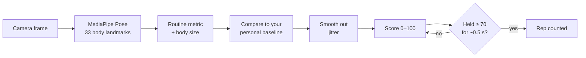

# How StepAlong scores movement

StepAlong turns a live camera feed into a 0–100 "match" score and a rep count, entirely in the browser. This document explains each step and why it exists.

## The pipeline



This runs on every video frame, for whichever routine is active.

### 1. Find the body

[MediaPipe Pose](https://github.com/google-ai-edge/mediapipe) returns 33 landmarks (shoulders, hips, knees, ankles, heels, toes, wrists, and so on) as x/y positions between 0 and 1 in the camera frame. The model runs on the device, and no video leaves the browser.

The coordinates are in the **raw, unmirrored** frame. The on-screen video is flipped with CSS so it feels like a mirror, but the maths always uses the raw frame.

### 2. Measure one thing, relative to body size

Each routine has a `rawMetric(landmarks)` function that reduces the pose to one number, such as "how far the hips have shifted sideways from the ankles".

That distance is then **divided by a body measurement**, either shoulder width or torso length. A child standing 3 m away and an adult standing 1 m away then produce the same number for the same movement, because both the movement and the ruler scale together.

### 3. Compare to *your* neutral stance

Everyone stands a little differently. During the 3-2-1 countdown the user stands still, and the app records the metric on each frame. The **median** of those samples becomes that person's baseline. The median ignores a few glitchy frames better than the mean does.

During the round, the app scores the **deviation from that baseline**:

- `mode: 'abs'`: movement in either direction counts, `|raw − baseline|` (sway left or right, heels up or toes up)
- `mode: 'up'`: only movement in one direction counts, `max(0, raw − baseline)` (raising a knee, reaching across)

If the countdown captured fewer than 8 samples (for example, the person stepped out of frame), the routine's built-in `defaultBaseline` is used instead.

### 4. Smooth out jitter

Landmark positions wobble by a few pixels between frames even when you stand perfectly still. Without smoothing, the score flickered between 0 and 100. An exponential moving average fixes this:

```
smoothed = 0.72 × previous + 0.28 × new
```

Each new frame moves the score about a quarter of the way toward the new value. That's steady enough to read, and still quick to respond.

### 5. Turn it into a score

```
score = round( clamp(smoothed ÷ amplitude, 0, 1) × 100 )
```

`amplitude` is the target size of the movement for the current difficulty tier. Reaching it scores 100, and half of it scores 50.

### 6. Count a rep only when it's real

Briefly passing through a good position doesn't count. A rep needs:

1. The score to stay at **70 or higher for about 550 ms** (the gold hold bar fills up), then
2. The score to fall back to **35 or lower** before the next rep can count.

Without step 2, holding one pose would count reps over and over. Frame timing is capped at 100 ms per step, so someone who walks out of frame and back in can't instantly fill the hold bar.

### 7. Round results

- **Average score** is the mean of the score at each counted rep, which measures rep *quality*. The first version averaged every frame, so time spent resting between reps unfairly dragged the score down.
- If no reps were counted, the average falls back to the mean of the top 25% of frame scores.

### 8. Adaptive difficulty

After a round with an average above 82 and at least 3 reps, the routine moves up a tier (there are three). A higher tier needs a bigger movement (`amplitude`), and the routines with a beat get a faster metronome.

## The routines

| Routine | What is measured | Divided by | Mode | Tier amplitudes | Beat |
|---|---|---|---|---|---|
| **Standing Sway** | Hip centre x − ankle centre x | shoulder width | either direction | 0.09 / 0.13 / 0.17 | – |
| **Heel-Toe Rocker** | Toe height − heel height | torso length | either direction | 0.06 / 0.09 / 0.12 | 50 / 60 / 70 bpm |
| **Cross-Body Horizon** | Wrist travel toward the opposite shoulder | shoulder width | one direction | 0.35 / 0.50 / 0.65 | – |
| **Exaggerated March** | Knee height relative to hip | torso length | one direction | 0.35 / 0.55 / 0.75 | 50 / 60 / 72 bpm |

For the march, the knee sits about 0.9 torso lengths below the hip when standing and level with the hip when the thigh is parallel to the floor.

> **Tuning status:** the amplitudes are starting estimates. They are being tuned against real people on real devices. Heel and toe landmarks are the noisiest, so Heel-Toe Rocker is the most likely to need adjustment.

## Saved data

Only scores are saved, in the browser's `localStorage`, and never any video:

| Key | Contents |
|---|---|
| `stepalong_sessions_v2` | Last 50 rounds: routine, date, average score, best score, reps, tier |
| `stepalong_difficulty_v2` | Current tier for each routine |
| `stepalong_setup_seen_v1` | Whether the first-run setup tips have been shown |

"Reset progress" on the Progress screen erases the first two.

## Testing

`npm test` runs `tests/e2e-smoke.js`. It loads the app in a simulated browser (jsdom), replaces the camera and MediaPipe with a fake that returns hand-made poses, and plays a shortened round of every routine. It checks that:

- moving between the rest pose and the target pose counts at least 3 reps with a high score
- standing still counts **zero** reps
- the results screen appears and the round is saved

This checks the logic, not whether the thresholds feel right on a real body. That needs a real camera.
