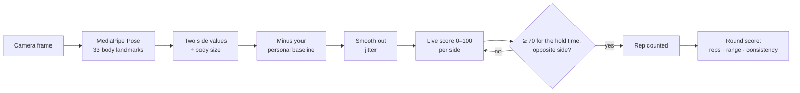

# How StepAlong scores movement

StepAlong turns a live camera feed into a live 0–100 "match" score, a rep count and a round score, entirely in the browser. This document explains each step and why it exists. The code is in the `SCORING` section of [`app.js`](../app.js).

## The pipeline



This runs on every video frame, for whichever routine is active.

### 1. Find the body

[MediaPipe Pose](https://github.com/google-ai-edge/mediapipe) returns 33 landmarks (shoulders, hips, knees, ankles, heels, toes, wrists, and so on) as x/y positions between 0 and 1 in the camera frame. The model runs on the device, and no video leaves the browser.

The coordinates are in the **raw, unmirrored** frame. The on-screen video is flipped with CSS so it feels like a mirror, but the maths always uses the raw frame. In the raw frame the person's right side is at *small* x, which matters for Cross-Body Horizon: an early version had that routine backwards because of it.

### 2. Two sides per routine, relative to body size

Every routine measures **two "sides"**: left and right knee, heels-up and toes-up, shift left and shift right, and so on. Each routine's `sides(landmarks)` function returns one number per side, for example "how far the hips have moved sideways from the ankles".

Each number is **divided by a body measurement**, either shoulder width or torso length. A child standing 3 m away and an adult standing 1 m away then produce the same number for the same movement, because both the movement and the ruler scale together.

### 3. Compare to *your* neutral stance

During the 3-2-1 countdown the user stands still, and the app records each side's value on every frame. The **median** of those samples becomes that person's baseline for that side. The median ignores a few glitchy frames better than the mean does. If the countdown captured fewer than 8 samples (for example, the person stepped out of frame), the routine's built-in `defaultBase` is used instead.

During the round, each side is scored on how far it has moved *past* the baseline:

```
deviation = max(0, raw − baseline)
```

### 4. Smooth out jitter

Landmark positions wobble by a few pixels between frames even when you stand perfectly still. An exponential moving average steadies them:

```
smoothed = 0.72 × previous + 0.28 × deviation
```

### 5. Live score: you have to earn it

```
ratio = smoothed ÷ tier amplitude            (1.0 = you reached the target size)
live  = round( 100 × clamp(ratio ÷ 1.2, 0, 1) ^ 1.5 )
```

| You move… | ratio | live score |
|---|---|---|
| a little | 0.3 | 13 |
| half the target | 0.5 | 27 |
| exactly the target | 1.0 | 76 |
| 20% past the target | 1.2 | 100 |

Reaching the target scores about 70, a 100 needs 20% more than the target, and tiny movements stay under 25. An earlier version gave 100 at exactly the target, and testers said the scores were too easy.

### 6. Count a rep only when it's real

For each side, a rep needs:

1. The live score to stay at **70 or higher** for the tier's **hold time** (the hold bar fills up), **and**
2. It must be the **opposite side** from the previous rep. Repeating the same side doesn't count, and the app prompts you to switch.

After counting, that side re-arms only once its score drops back to **35 or lower**, so holding one pose can't count reps over and over. Frame timing is capped at 100 ms per step, so someone who walks out of frame and back in can't instantly fill the hold bar.

### 7. Round score

Each round lasts 25 seconds. The score blends three parts:

```
repsPart  = clamp(reps ÷ target reps, 0, 1)
rangePart = mean over reps of clamp((peak ratio − 0.9) ÷ 0.3, 0, 1)
consPart  = 1 − (spread of peak sizes ÷ their average) ÷ 0.25     (needs 3+ reps)

score = round(100 × (0.40 × repsPart + 0.35 × rangePart + 0.25 × consPart))
```

- **Reps (40%):** did you reach the tier's rep target?
- **Range (35%):** how big was each counted rep? Just reaching the target earns half, and 20% past it earns full marks.
- **Consistency (25%):** were your reps the same size?
- If **no reps** counted, the score is only a quarter of the best live score, so moving without completing reps earns a little credit but not much.

The results screen shows the three parts as bars, plus a **left-vs-right** comparison. Each side's bar is the live score of its 95th-percentile movement. If you did at least 2 reps and one side is under 75% of the other, the weaker side's bar turns yellow and the tip names it, for example "Your right knee was weaker (45 vs 80). Lift your right knee higher." Otherwise the tip targets your weakest part (more reps, bigger range, or more even reps).

### 8. Tiers and levelling up

Each routine has three tiers: **Gentle, Steady and Strong**. A higher tier needs a bigger movement (amplitude), more reps, and a longer hold, and the rhythm routines get a faster beat. After a round with a score of **70 or more** that also reaches the rep target, the routine moves up one tier automatically. You can also pick a tier yourself on the practice screen.

The first-time setup sets the starting tier: "Very steady" starts on Tier 2, and everyone else starts on Tier 1. This only applies to routines that have no saved rounds yet.

## The routines

| Routine | Sides measured | Divided by | Tier 1 | Tier 2 | Tier 3 |
|---|---|---|---|---|---|
| **Standing Sway** | hip centre vs ankle centre, shifted left / right | shoulder width | amp .18, hold 0.6 s, 6 reps | .26, 0.75 s, 8 | .34, 0.9 s, 10 |
| **Heel-Toe Rocker** | toes vs heels height: heels up / toes up | torso length | amp .10/.06, 0.4 s, 8 reps, 50 bpm | .14/.08, 0.5 s, 12, 60 bpm | .18/.10, 0.6 s, 16, 70 bpm |
| **Cross-Body Horizon** | each wrist's travel toward the opposite shoulder | shoulder width | amp .45, 0.4 s, 6 reps | .65, 0.5 s, 8 | .85, 0.6 s, 10 |
| **Exaggerated March** | each knee's height relative to its hip | torso length | amp .45, 0.15 s, 10 reps, 50 bpm | .65, 0.2 s, 14, 60 bpm | .85, 0.25 s, 18, 72 bpm |

Heel-Toe Rocker has a smaller target for "toes up", because lifting the toes is a smaller movement than rising onto them. For the march, the knee sits about 0.9 torso lengths below the hip when standing, so the baseline model scores the *lift*, not the absolute knee height. An early version required the knee to reach hip height, which is nearly impossible.

> **Tuning status:** these values were tuned after "too easy" feedback and are being checked against real people on real devices. Add `?debug` to the URL to see each side's raw deviation, target and score live.

## Free Movement

Free Movement doesn't compare you to a fixed routine. You pick body parts (arms, legs, torso), an intensity (low ×0.6, medium ×1, high ×1.5 the target size) and a pace (slow 8, medium 14, fast 20 target reps), or a preset such as jumping jacks.

- Each body part has several candidate **signals**. For arms these are arm raise, arm spread and alternating arms. The app tracks all of them and uses whichever one is actually repeating.
- A **zig-zag cycle detector** counts one cycle each time a signal rises by at least 80% of its target size and turns back.
- **Reps = the smallest cycle count across the parts you picked.** If you choose arms and legs but only move your legs, you score 0 reps.
- The round score uses the same reps, range and consistency formula, and the results show a **by-body-part** breakdown instead of left vs right.

## Saved data

Only settings and scores are saved, in the browser's `localStorage`, and never any video:

| Key | Contents |
|---|---|
| `stepalong_profile_v1` | Name (optional), goal, steadiness, practice days and rounds per session, accessibility and sound settings, whether setup is done |
| `stepalong_sessions_v3` | Last 50 rounds, newest first: routine, date, round score, best live score, reps, tier, the three score parts, side scores, and the tip |
| `stepalong_difficulty_v3` | Current tier for each routine |
| `stepalong_setup_seen_v1` | Whether the first-run setup tips have been shown |
| `stepalong_custom_v1` | Your last Free Movement setup |

Settings → "Reset progress" erases rounds and tiers. "Start over" erases everything and replays the first-time setup. Rounds saved by the earlier version of the app (`_v2` keys) used the old, easier scoring, so they're ignored rather than mixed in.

## Testing

`npm test` runs two suites in a simulated browser (jsdom). Each replaces the camera and MediaPipe with a fake that returns hand-made poses.

**`tests/e2e-smoke.js`** plays shortened rounds of every routine and checks that:

- alternating full-size reps count, but a 100 isn't handed out
- standing still scores about 0, and tiny movements don't count
- repeating the same side counts only once
- Tier 3 is harder than Tier 1
- the live cue and the results tip tell you what to do
- the round is saved with its breakdown, side scores and tip
- a lopsided round names the weaker side, and a balanced one doesn't

For Free Movement it checks that jumping jacks count, moving only your legs during jumping jacks scores 0, and tiny arm movements don't count.

**`tests/nav-smoke.js`** walks through the first-time setup, return visits, all four tabs, routine pages, Settings, Home and Progress with history, and the reset buttons.

These tests check the logic, not whether the thresholds feel right on a real body. That needs a real camera.
